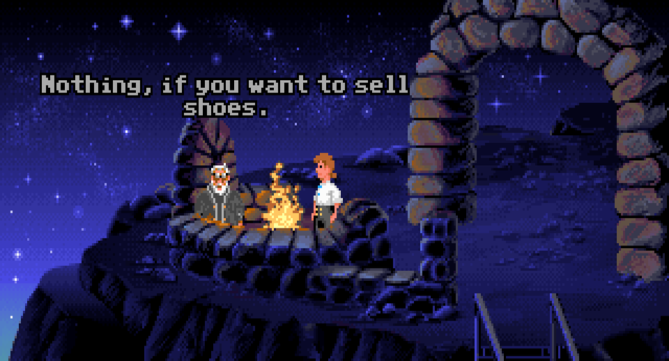

  

<h2 align="center">Ask a running game what it's thinking.</h2>

SCRY connects your AI client to MAME and DOSBox-X: it stops the program, reads its memory by name and presses its inputs.

  

  
  

  <a href="https://scryai.net"><picture><source media="(prefers-reduced-motion: reduce)" srcset="scry-dosbox-x-4x3.png"></picture></a>

<em>Your client writes a new line into Monkey Island's memory, and the lookout says it.</em>

SCRY is two [MCP](https://modelcontextprotocol.io) servers, one per emulator. Each keeps its
emulator open at the debugger, and every reply carries its evidence.

- **[scry-mame](https://github.com/scry-mcp/scry-mame#install)**: an arcade board or a home
  computer running in MAME.
- **[scry-dosbox-x](https://github.com/scry-mcp/scry-dosbox-x#install)**: a DOS program running
  in DOSBox-X.

Both run on macOS and Windows, and need git, [uv](https://docs.astral.sh/uv/) and the emulator
built with its debugger. Each server's README has the lines to paste into your MCP client, and
a first question to ask.

## What you can ask

- **"Who writes this byte?"** A watch stops the program as soon as the byte changes.
- **"Where does the game keep its credits?"** A scan narrows memory to the bytes that changed
  with the value.
- **"What happens if I press this?"** Press a control or a key, then read the screen.

Both servers are built on [scry-core](https://github.com/scry-mcp/scry-core), the shared
package; [scry-site](https://github.com/scry-mcp/scry-site) builds scryai.net from their
documents.

Developed by Optimiza ([Marcos Hernández](https://www.linkedin.com/in/optimiza/)), in collaboration with [MS-DOS Club](https://msdos.club) and its [podcast](https://www.ivoox.com/podcast-ms-dos-club_sq_f11160693_1.html).
